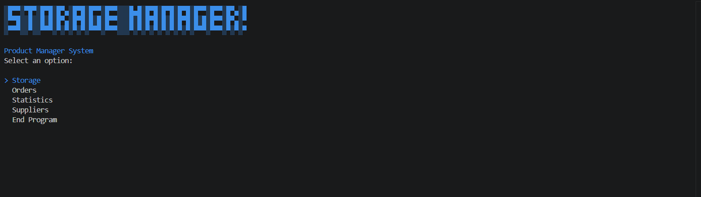
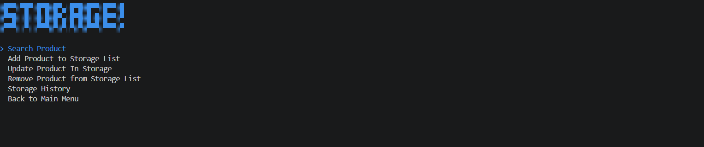
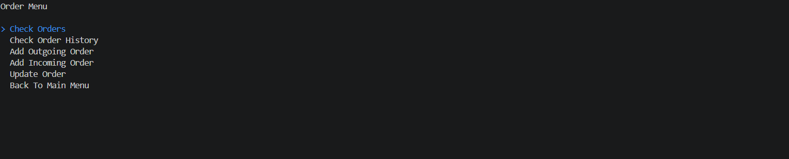
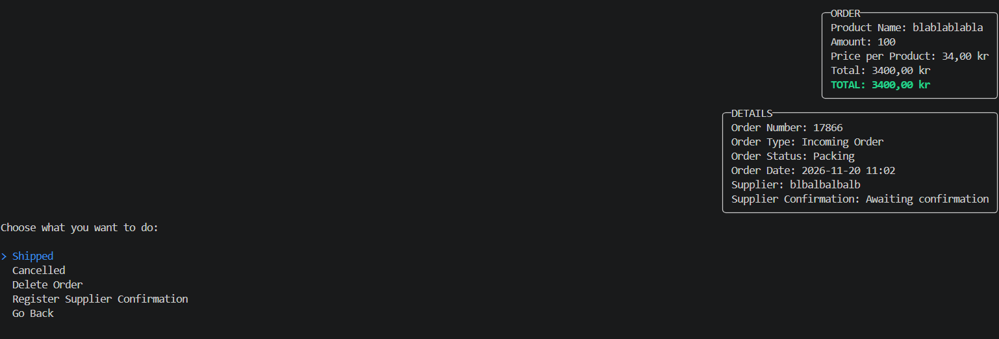
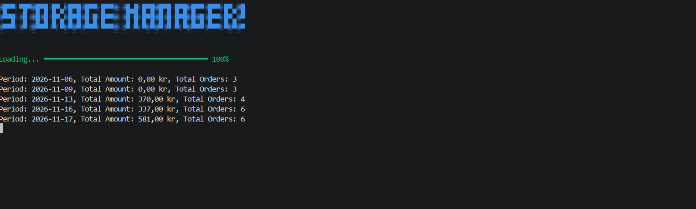
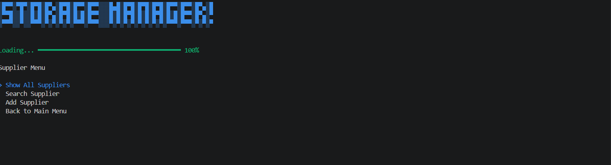

# Order & Lagerhanteringssytem

## 1. 
Detta projekt är ett order & lagerhanteringssystem utvecklat i C#.

Syftet med detta program är att kunna hantera produkter, ordrar och lagersaldon. Användaren kan lägga till, uppdatera, ta bort och söka efter produkter och ordrar. Man kan även se statestik av inkommande och utgående ordar, samt kolla leverantörer.

Allt som görs i programmet lagras och försvinner inte när du avslutar programmet.

## 2.

## 3.
Ladda ner Git och .NET SDK. Högerklicka på lokala mappen där du vill ha projektet och tryck på "Open git bash here" Clonea ner repositoriet genom att skriva "git clone "URL". Alltså URL ifrån github repo. Denna länken är URL: https://github.com/LuneVee/Assignment-Group_Project.git Sedan öppnar projektet i Visual Studio Code genom att högerklicka på lokala mappen och tryck på VS code. Sedan öppnar man terminalen i Program.cs och skriver dotnet run. Därefter får man upp en menyn och sedan är det bara att sätta igång med det man vill göra.